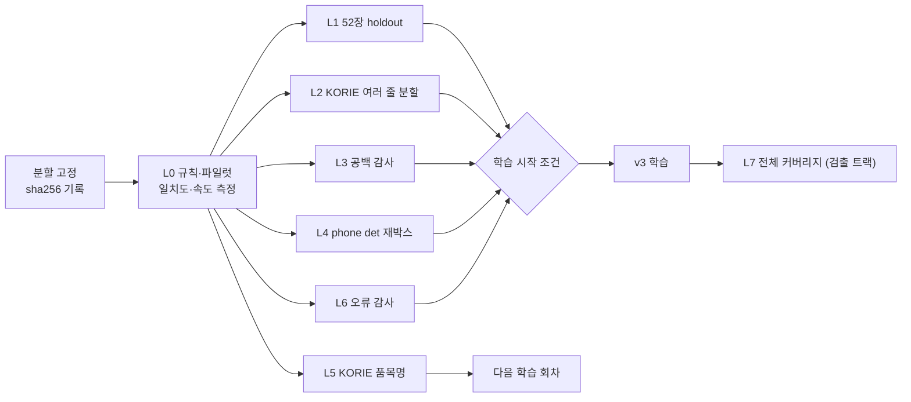

# OCR v3 데이터셋 재라벨링 계획

작성 2026-11-20 · 연결 문서 `OCR_v3_재학습계획_20261120.md`(성능 분석) · 작업자 지시문 `OCR_v3_라벨링지시문_20261120.md`

- 이 계획은 학습 성능(CER·EM)이 낮았던 원인 가운데 **라벨과 데이터로 고칠 수 있는 것**을 골라 작업 묶음으로 만든 것이다.
- **[확인]**: 기존 문서·파일로 확인한 내용이다. **[이번 확인]**: 이번에 직접 집계한 내용이다. **[추정]**: 검증하지 않은 내용이다.
- 이 문서를 쓰면서 라벨·데이터는 수정하지 않았다.
- [이번 확인] 수치는 다음 스크립트로 다시 계산할 수 있다.
  - `ocr_v3_plan_20261120_assets/scripts/label_stats.py`: 제외 사유, 공백, IE 분할
  - `regroup.py`: 영수증 단위 분할, 여러 줄 수
  - `comp.py`: 오류 출처

---

## 0. 요약

### 성능이 낮았던 원인과 라벨링으로 고칠 수 있는 범위

| # | 원인 | 근거 수치 | 라벨링으로 고칠 수 있나 |
|---|---|---|---|
| R1 | **KORIE 여러 줄 crop.** 두 줄짜리 이미지에 한 줄 정답(공백으로 이음)이 붙어 있다. | crop 1,374개(분할별 821/281/272). KORIE val CER의 53~61%(12.8~16.3%p) [이번 확인] | **예.** 줄 단위로 나눠 다시 라벨링하면 학습·평가 데이터가 모두 정상화된다. |
| R2 | **phone 박스 불량.** 인접 줄이 섞이거나 글자가 잘려 학습에서 빠졌다. | 제외 1,732줄 중 박스 문제 1,295줄(75%) [이번 확인] | **예.** 박스를 다시 잡으면 학습 줄이 최대 약 15% 늘어난다. |
| R3 | **학습 박스와 배포 검출 박스의 형태 차이.** 사람 박스(Windows OCR 초안 + 수정)로 학습하고, 배포에서는 PP-OCRv5 det 박스로 추론한다. | 전체 OCR 매칭 줄 CER 5.28 vs 사람 crop CER 2.28 [확인, v1] | **예.** det 박스로 crop을 만들고 정답을 옮긴다. |
| R4 | **공백 표기 불일치.** | 4자리 연도 날짜가 있는 KORIE crop 693개 중 181개(26%)가 `2023. 10. 25` 형태, phone 날짜는 265개 중 6개(2%) [이번 확인]. KORIE EM 손실 86건 중 27건이 공백만 다름 [확인, v1 3-B] | **예.** 이미지 기준 공백 규칙 하나로 통일하고 감사한다. |
| R5 | **KORIE 한글 다양성 부족.** 한글 문자열 296종, 숫자 62%. S1 후 phone 한글 오류 4.8 → 27.4% | 그림 6·7(재학습 계획 문서) | **부분적으로.** KORIE 원본 영수증의 품목명 줄(공식 OCR crop에 없음)을 새로 라벨링한다. |
| R6 | **미관측 test 없음, KORIE 영수증 단위 누수** | 52장 미검수, 공식 OCR 분할의 영수증 606장이 세 분할에 걸침 [이번 확인] | **예.** 분할을 먼저 고정하고 52장을 검수해 holdout으로 쓴다. |
| R7 | **라벨 오류율을 모른다.** KORIE 라벨은 감사한 적이 없다. phone 제외 사유는 자유 서술 233종이다. | [이번 확인] | **예.** 표본 감사, 사유 코드 고정 |
| — | 24자 이상 긴 문자열(CER 약 60%) | KORIE val 단일행 오류의 47~65% | **아니오.** `max_text_length`와 학습 폭 문제다(재학습 계획 v3_d). 라벨은 정확히 달고 `long` 표시만 한다. |
| — | 검출 누락(전체 OCR CER 약 10.2%p) | [확인, v1 3-G] | **이번 범위 밖(P2).** 전체 커버리지 박스를 라벨링하면 검출 평가·학습 데이터가 생긴다. |

### 작업 묶음

| 묶음 | 내용 | 대상 수 | 우선 |
|---|---|---:|---|
| L0 | 규칙 확정 + 파일럿(이중 라벨링으로 일치도 측정) | 영수증 20장 | P0 |
| L1 | 52장 검수 → 외부 holdout | 52장(초안 약 2,130줄) | P0 |
| L2 | KORIE 여러 줄 crop을 줄 단위로 분할 | 1,374 crop | P0 |
| L3 | 형식 필드(날짜·시간·전화) 공백 감사·통일 | KORIE 2,574 crop 중 공백 있는 186개 전수 + 표본, phone 해당 줄 | P0 |
| L4 | phone 304장 박스 재생성(det 기준) + 제외 줄 복구 | 8,343 verified + 1,732 excluded | P1(학습 전 권장) |
| L5 | KORIE 품목명 줄 신규 라벨(한글 보강) | 원본 774장, IE 행 2,886개를 초안 힌트로 | P1 |
| L6 | 라벨 오류 감사(train은 모델 불일치 우선, val/test는 무작위 블라인드) | 데이터셋·분할별 300줄 표본 + train 의심 줄 | P1 |
| L7 | phone val/test 영수증 전체 커버리지 박스(검출 평가용) | 약 120장 | P2 |

- **학습 시작 조건:** L0~L3 완료. 가능하면 L4·L6까지 마친 뒤 v3 학습을 시작한다.
- L5는 v3 1차 학습과 병행하고, 완료되면 다음 학습 회차에 투입한다.

---

## 1. 공통 원칙

1. **분할을 먼저 고정한다.** 라벨링을 시작하기 전에 영수증 단위 분할 파일을 만들고 sha256을 기록한다.
   - KORIE: 검출 데이터 분할(train 408 / val 135 / test 131장, crop이 있는 영수증 기준)
   - phone: v2 그룹 분할 규칙
   - 52장: holdout
   - 새로 만드는 줄(L2 분할, L4 재박스, L5 품목명)은 원래 영수증의 분할을 그대로 따른다.
2. **원본은 수정하지 않는다.** 모든 결과는 새 라벨 버전 폴더(`ocr_v3/data/labels_v3/`)에 쓴다. 바뀐 줄은 `original_text`와 변경 사유를 함께 남긴다.
3. **규칙을 먼저 고정하고 바꿀 때는 버전을 올린다.** 지시문을 v1.0으로 고정한다. 규칙이 바뀌면 v1.1로 저장하고, 이미 한 작업에 영향이 있는지 기록한다.
4. **평가 데이터는 블라인드로 라벨링한다.**
   - val/test/holdout 줄을 라벨링할 때 평가 대상 인식 모델(pretrained, v1, v2, v3)의 예측을 초안으로 보여 주지 않는다.
   - 모델 예측으로 검수 대상을 고르는 방식(L6의 train 방식)도 val/test에는 쓰지 않는다. 모델에 유리한 쪽으로 정답이 고쳐지는 편향을 막기 위해서다.
5. **판독할 수 없으면 제외한다.** 추측으로 채운 정답은 학습에 해롭다. 대신 제외 사유를 고정 코드로 남긴다.
6. **라벨 버전이 바뀌면 기준을 다시 잰다.** v1·v2 수치와 직접 비교하지 않는다. 같은 라벨 버전에서 공식 pretrained와 v1 최종을 다시 평가해 기준으로 쓴다.

---

## 2. 작업 묶음별 계획

### L0. 규칙 확정 + 파일럿 (P0)

- 대상: phone 10장 + KORIE 10장(분할 train에서만 무작위).
- 방법: 작업자 2명(또는 사람 1명 + 에이전트 1명)이 서로의 결과를 보지 않고 같은 영수증을 라벨링한다.
- 측정:
  - 줄 단위 EM 일치율
  - 작업자 간 CER
  - 공백만 다른 줄 수
  - 박스 IoU
  - 영수증당 소요 시간
- 통과 기준(초기값, 파일럿에서 조정):
  - 텍스트 EM 일치 ≥ 97%
  - 작업자 간 CER ≤ 0.5%
  - 공백 불일치 ≤ 1% 줄
- 기준에 못 미치면 불일치 줄을 모아 규칙을 보완하고 지시문을 v1.1로 낸다.
- 산출: `rules_version.json`, 파일럿 일치도 보고, 실측 속도(이후 일정 산출에 사용).

### L1. 52장 검수 → 외부 holdout (P0)

- 현재 라벨 52/52가 `auto_labeled_needs_review` 상태다(Windows OCR 자동 초안) [확인].
- 304장과 원본 SHA가 같은 28장은 phone 분할을 따른다. 나머지 **24장이 유일한 미관측 holdout**이다 [확인, v2].
- 방법:
  - 24장은 **전 줄을 빠짐없이 검수**한다. 모델 예측은 보여 주지 않는다.
  - 박스는 L4와 같은 det 기준으로 만든다. 그래야 배포 경로 평가와 같은 형태가 된다.
  - 28장은 phone 라벨과 비교만 하고 따로 라벨링하지 않는다.
- 산출: `holdout52/` 줄 라벨, 검수 완료 표시. 이후 이 24장으로는 학습도, 규칙 조정도 하지 않는다.

### L2. KORIE 여러 줄 crop 분할 (P0)

- 대상: 가로/세로 비 < 1인 crop 1,374개(새 분할 train 821 / val 281 / test 272) [이번 확인].
- 문제: 두 줄 이상이 찍힌 이미지에 한 줄 정답이 붙어 있다. 단일행 인식기는 이 형태를 배울 수 없다. 배포 검출기도 줄 단위 박스를 준다.
- 방법:
  1. crop 안에서 줄마다 박스를 그린다(축 정렬 사각형이면 충분하다).
  2. 기존 정답 문자열을 줄 단위로 나눈다. 기존 정답의 글자는 바꾸지 않는 것이 원칙이다. 이미지와 다르면 이미지를 따르고 `text_changed` 표시를 한다.
  3. 새 줄 ID는 `<원래 crop ID>#l1`, `#l2` 형식으로 붙이고 `parent_id`를 남긴다.
- 평가 처리: val/test의 여러 줄 crop은 줄 단위 정답을 새로 갖는다. 원래 여러 줄 집계는 비교용으로 계속 남긴다.
- 기대 효과:
  - KORIE val 오류의 절반 이상을 차지하던 구간이 정상적인 단일행 평가로 바뀐다.
  - train에 한글이 많은 주소·상호 줄이 추가된다 [추정, 여러 줄 crop의 필드 구성에 따라 다름].

### L3. 형식 필드 공백 감사·통일 (P0)

- 대상 [이번 확인]:

| 데이터 | 필드 | 전체 crop | 4자리 연도 날짜 형태 | 그중 공백 있음 | 날짜 형태 아님 |
|---|---|---:|---:|---:|---:|
| KORIE | TransactionDate | 673 | 380 | 115 | 293 |
| KORIE | PaymentDate | 644 | 313 | 66 | 331 |
| KORIE | TransactionTime | 669 | — | 4 | — |
| KORIE | MerchantPhoneNumber | 588 | — | 1 | — |
| phone | 날짜 형태 줄 | — | 265 | 6 | — |

- "날짜 형태 아님"은 2자리 연도, 시간만 있는 crop 등 정규식 `(19|20)\d{2}[.-/년]…`에 잡히지 않은 crop이다. 형식을 아직 확인하지 않았다.
- 방법:
  1. 공백이 있는 KORIE crop 186개를 전부 본다. 공백이 없는 날짜 crop 100개와 날짜 형태가 아닌 crop 100개는 무작위로 본다. 이미지의 실제 간격을 지시문 §5-3 공백 규칙으로 판정한다.
  2. 판정 결과로 둘 중 하나를 고른다.
     - **(a)** 라벨이 이미지를 따르고 있다(영수증마다 실제 인쇄가 다르다). 그러면 라벨을 유지한다.
     - **(b)** 라벨이 이미지와 다르다(작업자 관례 차이). 그러면 규칙에 맞게 일괄 수정한다. 수정 전 문자열은 `original_text`에 남긴다.
  3. phone 날짜 6줄도 같은 규칙으로 확인한다.
- 산출: 공백 판정표, 수정 목록, 수정 전후 KORIE 날짜 필드 공백 비율.
- 왜 필요한가: 공백 관례가 섞여 있으면 phone을 학습할수록 KORIE EM이 떨어지는 현상(v1 3-B)이 반복된다. 원인이 라벨인지 실제 인쇄인지를 먼저 가려야 한다.

### L4. phone 304장 박스 재생성 + 제외 줄 복구 (P1, 학습 전 권장)

- 문제 1(R2): 제외 1,732줄의 사유 분포는 다음과 같다 [이번 확인].

| 분류 | 줄 | 예 |
|---|---:|---|
| 박스 문제: 인접 줄 혼입, 여러 줄, 글자 잘림, 재크롭 필요 | 1,295 | "Adjacent line enters crop" 224, "Multiple clipped lines" 158 |
| 판독 불가: 손글씨, 마스킹 개수 불명, 겹친 인쇄, 흐림 | 227 | |
| 문자 아님: 바코드, 배경 | 142 | |
| 기타 | 68 | |

  - 사유가 자유 서술이라 233종으로 흩어져 있고, 한국어·영어가 섞여 있다.
- 문제 2(R3): 학습 crop은 Windows OCR 초안 박스를 사람이 고친 것이다. 배포는 PP-OCRv5 mobile det 박스(동결 영역 정책 1920/max/0.3/0.45/1.2)로 자른다.
- 방법:
  1. 304장 정렬 이미지(`aligned_images/`)에 배포와 같은 det 설정을 돌리고 박스를 저장한다. det 결과는 한 번만 만들고 해시로 고정한다.
  2. 각 det 박스를 기존 verified 줄과 IoU로 매칭한다.
     - **1:1이고 IoU ≥ 0.7:** 기존 정답을 옮긴다. 작업자는 이미지와 대조해 확인만 한다.
     - **det 박스가 verified 줄 하나의 일부이거나 여러 개에 걸침:** 정답을 새로 쓴다. 박스는 det 결과를 따르되, 두 줄을 합친 박스는 나누고 글자를 자른 박스는 넓힌다.
     - **매칭되는 verified 줄이 없음:** 새 줄로 라벨링한다(인쇄 글자일 때).
  3. 기존 제외 줄 중 박스 문제 1,295줄은 새 박스에서 다시 판정한다. 나머지 437줄은 고정 사유 코드로 옮겨 적는다.
- 초안 정책: train 분할 줄은 v1 최종 모델 예측을 초안으로 써도 된다. val/test 줄은 기존 verified 정답만 초안으로 쓴다(블라인드 원칙).
- 산출: det 기준 crop과 줄 라벨, 기존 사람 박스 crop(보존), 매칭 보고(1:1, 분할, 병합, 신규, 미매칭 수).
- 학습 계획과의 연결:
  - 두 crop 세트(사람 박스, det 박스)를 함께 학습할지는 재학습 계획에 run 하나를 추가해 비교한다.
  - 평가는 det 박스 crop을 주 평가로 둔다. 배포 경로와 같기 때문이다.

### L5. KORIE 품목명 줄 신규 라벨 (P1)

- 문제(R5): KORIE 공식 OCR crop은 key-information 필드만 있어 품목명이 없다. 한글 문자열이 296종뿐이다.
- 자원 [이번 확인]:
  - 원본 영수증 774장(`ocr_v3/data/korie/receipts`)
  - IE CSV 2,886행(train 1,731 / validation 577 / test 578). 이 중 2,854행의 `Item_Name`에 한글이 있다.
  - 주의: IE CSV의 분할도 검출 분할과 다르다(예: IE train 1,731행 중 722행이 검출 val/test 영수증). 새 줄은 **검출 분할을 따른다.**
- 방법:
  1. 원본에 det를 돌려 품목 영역의 줄 박스를 만든다.
  2. IE CSV의 `Item_Name`을 초안 힌트로 쓴다. 이 값은 `[코드], 품목명, 단가, 수량, 바코드, 금액`이 쉼표로 이어진 형태라 그대로 정답으로 쓰지 않는다.
  3. 작업자가 이미지와 대조해 줄별 정답을 입력한다.
  4. 품목명 줄을 우선하고, 같은 줄에 붙은 숫자 열은 det 박스 단위를 따른다.
- 목표량: 1차로 train 영수증 408장의 품목명 줄. val/test 영수증 줄은 평가용으로 같은 규칙으로 만들되 블라인드로 라벨링한다.
- 기대 효과: KORIE 쪽 한글 문자열 종류가 크게 늘어 혼합 학습에서 한글 망각을 줄인다 [추정].

### L6. 라벨 오류 감사 (P1)

| 대상 | 방법 | 표본 |
|---|---|---|
| KORIE val/test, phone val/test, holdout | **무작위 블라인드 표본.** 모델 예측을 보지 않는다. | 데이터셋·분할마다 300줄. 오류율이 5%일 때 95% 구간은 ±2.5%p |
| KORIE train, phone train | **모델 불일치 우선 검수.** pretrained와 v2 S1·v1 최종 예측이 서로 같은데 정답만 다른 줄을 먼저 본다. | 의심 줄 전부 + 무작위 300줄 |

- 산출: 데이터셋별 라벨 오류율(구간 포함), 오류 유형(공백, 문자 오인, 누락, 박스), 수정 목록.
- 판단: 평가 데이터 오류율이 높으면(예: 3% 이상) 해당 분할을 전수 검수할지 사용자와 정한다.

### L7. 전체 커버리지 박스 (P2)

- 대상: phone val/test 영수증(약 120장)과 holdout 24장.
- 내용: 인쇄된 모든 글자 줄에 박스와 정답을 단다. 지금의 부분 GT로는 측정할 수 없던 검출 precision과 오검출을 측정한다.
- 이 데이터는 검출기 학습·평가 트랙에서 쓴다. 인식기 v3 범위 밖이다.

---

## 3. 라벨 형식과 산출물

### 3-1. 줄 레코드 (`labels_v3/lines.jsonl`, 한 줄 = 한 텍스트 박스)

| 키 | 예 | 설명 |
|---|---|---|
| `line_id` | `phone:r017:det034` | 출처·영수증·박스 번호 |
| `source` | `korie_official` / `korie_split` / `korie_item` / `phone` / `holdout52` | |
| `receipt_id` | `IMG00123`, `r017` | |
| `split` | `train` / `val` / `test` / `holdout` | 1단계 분할 파일에서만 가져온다 |
| `image`, `coordinate_image` | 상대 경로 | 박스 좌표 기준 이미지 |
| `box` | `{"type":"quad","points":[[x,y]×4]}` | 시계 방향, 왼쪽 위부터 |
| `crop` | `data/text_crops/v3/...png` | 생성 도구와 OS를 manifest에 기록 |
| `text` | | NFC, 지시문 §5 규칙 |
| `original_text` | | 수정 전 정답(있을 때) |
| `status` | `verified` / `excluded` / `needs_decision` | |
| `exclude_code` | `E01`~`E09` | 지시문 §6 고정 코드 |
| `flags` | `["oov","long","masked","uncertain_space"]` | |
| `draft_source` | `korie_official` / `phone_v2_verified` / `v1_final_pred` / `ie_csv` / `windows_ocr` / `none` | |
| `parent_id` | | 분할·재박스의 원래 ID |
| `annotator`, `reviewer`, `reviewed_at`, `rules_version` | | |

### 3-2. 학습 목록

- `labels_v3/rec_{train,val,test,holdout}.txt`: `상대경로<TAB>정답`. `status=verified`만 넣는다.
- 보류 사유(OOV, 길이)는 학습 목록 생성 단계에서 적용한다. 라벨 단계에서는 `flags`로만 표시한다.

### 3-3. 함께 남길 것

- `manifest.json`: 원본·라벨·crop 해시, 도구 버전, OS·OpenCV 버전, 규칙 버전
- `changes.csv`: 바뀐 줄의 이전 값, 새 값, 사유, 작업자
- 묶음별 보고: 처리 줄 수, 상태별 수, 사유 코드별 수, 이중 라벨링 일치도

---

## 4. 품질 관리

| 단계 | 검사 | 기준 |
|---|---|---|
| 자동(매 저장) | NFC 불변, 앞뒤·연속 공백 없음, 탭·개행 없음, 사전 OOV 표시 누락 없음 | 위반 0 |
| 자동 | 박스가 이미지 안, crop 파일 존재·비어 있지 않음, `split`이 분할 파일과 일치 | 위반 0 |
| 자동 | 같은 영수증이 두 분할에 없음, 분할 간 crop SHA 중복 0 | 0 |
| 자동 | `excluded`에 코드가 있음, `needs_decision`에 메모가 있음 | 위반 0 |
| 이중 라벨링 | 묶음마다 10% 줄을 다른 작업자가 블라인드로 다시 라벨링 | EM 일치 ≥ 97%, CER ≤ 0.5%(L0 이후 조정) |
| 검토자 확인 | 사유 코드 분포가 이전 묶음과 크게 다르면 표본 재확인 | — |
| 묶음 승인 | 위 항목 통과 + 미결정 줄 처리 완료 | 승인 기록 |

- 이중 라벨링이 기준에 못 미치면 해당 묶음을 전수 재검수한다.

---

## 5. 순서와 일정

- 일정은 L0에서 잰 속도(줄/시간)로 계산한다. 이 문서에서는 속도를 가정하지 않는다.
- 계산식: 묶음 시간 ≈ 대상 줄 수 ÷ 실측 속도 × 1.1(이중 라벨링 10%) + 미결정 처리 시간.

---

## 6. 재학습 계획에 미치는 영향

| 항목 | 변경 |
|---|---|
| KORIE 데이터 | 공식 crop + L2 분할 줄 + (다음 회차) L5 품목명 줄. 여러 줄 crop은 학습 목록에서 빠지고 줄 단위로 대체된다. |
| phone 데이터 | L4 이후 det 박스 crop이 주 평가가 된다. 사람 박스 crop은 학습 보조 후보다. |
| 선택 규칙 | KORIE 여러 줄 지표 대신 L2 분할 줄의 단일행 지표를 쓴다. 공백 제거 지표는 L3 결과에 따라 보호에서 뺄 수도 있다. |
| 기준값 | 라벨 버전 v3에서 pretrained·v1 최종을 다시 평가해 새 기준으로 쓴다. |
| test | KORIE 새 test, phone test(det crop), holdout 24장. 모두 블라인드 라벨링 후 동결한다. |

---

## 7. 사용자가 정할 것

| # | 결정 | 권장 |
|---|---|---|
| 1 | 작업자 구성(사람만 / 에이전트 초안 + 사람 확정 / 에이전트만) | 에이전트 초안 + 사람 확정. val/test/holdout은 사람이 최종 확인한다 |
| 2 | L3에서 공백 라벨이 이미지와 다를 때 일괄 수정 여부 | 수정(원래 값 보존) |
| 3 | L4 det 박스 crop을 학습에도 쓸지 | 평가는 det crop, 학습 사용 여부는 run 비교로 결정 |
| 4 | L5를 v3 1차 학습 전에 끝낼지 | 병행하고 다음 회차에 투입 |
| 5 | 구분선 줄(`-----`, `=====`) 처리 | 제외(E07). 기존 phone 라벨도 구분선만 있는 줄이 0개다 [이번 확인] |
| 6 | 영수증 원문을 외부 서비스(LLM API 등)로 보내도 되는지 | 보내지 않음. 개인정보(카드번호 일부, 상호, 주소) 때문이다 |

## 8. 한계

- 제외 사유 분류(박스 문제 1,295줄 등)는 자유 서술 사유를 키워드로 묶은 것이다. 일부는 다른 분류에 들어갈 수 있다.
- 공백 집계는 정규식으로 날짜 형태를 찾은 것이다. phone 시간 형태는 앞뒤 문맥(예: `시간: 12:30`)과 섞여 신뢰할 수 없어 표에서 뺐다.
- L2·L5로 늘어날 줄 수는 작업 전에는 알 수 없다. 작업 후 집계한다.
- 라벨링 속도와 일정은 L0 실측 전이라 적지 않았다.
