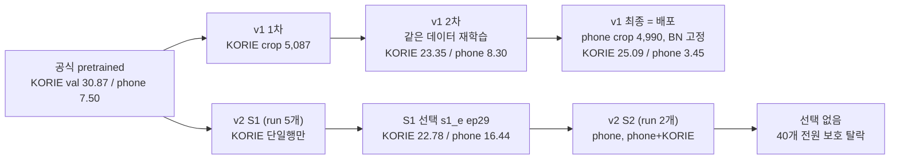
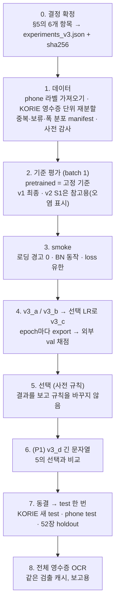

# OCR v3 재학습 계획: v1·v2 결과 시각화와 개선안

작성 2026-11-20 · 대상 모델 `korean_PP-OCRv5_mobile_rec`(PPLCNetV3 + SVTR + CTC/NRTR) · 작업 폴더 `D:\ssafy\ocr\ocr_v3`

- 근거 자료는 다음과 같다.
  - v1: `ocr_v2/mogumogu_ocr/`(1차·2차·최종)
  - v2: `ocr_v2_retrain/`(문서 2개, `outputs/v2/` epoch별 summary·predictions)
  - v3: `ocr_v3/`(원본 데이터, `training.yaml`)
- **[확인]**: 기존 문서나 파일로 확인한 내용이다. **[이번 확인]**: 이 문서를 쓰면서 직접 다시 계산한 내용이다. **[추정]**: 검증하지 않은 가설이다.
- 수치는 모두 batch 1 외부 평가 기준이다(v2 결정 D-6). CER은 NFC 정규화 후 (총 편집거리 ÷ 총 정답 문자 수)이고, 공백과 구두점을 보존한다. EM은 문자열 완전 일치율이다.
- 이 문서를 쓰면서 학습·추론은 실행하지 않았다. 기존 파일도 수정하지 않았다.
- 그림과 재현 스크립트는 `ocr_v3_plan_20261120_assets/`에 있다. 다시 그리려면 `python -I ocr_v3_plan_20261120_assets/scripts/make_figs.py`를 실행한다.
- 영수증 원문은 이 문서에 넣지 않았다. 집계값만 적었다.

---

## 0. 요약

### 지금 상태

| 항목 | 내용 |
|---|---|
| 배포 중인 모델 | v1 최종(스마트폰 튜닝). phone_val CER **3.45**. 단, v2와 다른 phone 분할에서 학습했으므로 낙관적일 수 있다 [추정]. |
| v2에서 가장 좋은 KORIE 모델 | S1 선택(s1_e ep29). KORIE 단일행 CER **11.16**. 대신 phone CER이 7.50 → **16.44**로 나빠졌다. |
| v2 S2 | 후보 40개가 모두 보호 조건에서 탈락했다. test는 열지 않았다. |

### 이번에 새로 확인한 사실 4가지 [이번 확인]

1. **KORIE 공식 OCR 분할은 영수증 단위로 섞여 있다.**
   - crop 파일명의 `IMGxxxxx`는 원본 영수증 ID다. 표본 180개 중 145개(81%)가 같은 ID 영수증의 박스 영역과 픽셀 단위로 일치했다(평균 절대 차 중앙값 0.9).
   - 영수증 674장 중 **606장은 crop이 train·val·test 세 분할에 모두 들어 있다.**
   - 공식 val crop 1,785개는 **모두** 공식 train에 다른 필드 crop이 있는 영수증에서 나왔다.
   - v2 문서 D-5의 추정("번호는 split마다 따로 매긴 것")은 틀렸다.
2. **KORIE val 오류의 75~86%는 표본의 18%에서 나온다.** 여러 줄 crop 268개와 24자 이상 단일행 54개다.
   - 24자 이상 54줄만 빼도 S1 선택 모델의 단일행 CER은 11.16 → **4.44**가 된다.
3. **S1이 phone을 망친 직접 원인은 한글이다.** phone 한글 문자 오류율이 4.8% → **27.4%**로 올랐다. 숫자는 0.8% → 1.0%로 거의 그대로였다.
   - KORIE train crop은 숫자가 62%다. 한글이 들어간 문자열은 **296종**뿐이다. phone은 3,243종이다.
4. **s2_b는 거의 통과했다.** 20 epoch 중 16개가 여러 줄 CER을 뺀 보호 조건 4개를 모두 통과했다. 탈락 원인은 여러 줄 보호 하나였다.

### v3 핵심 개선 5가지

| 우선 | 개선 | 근거 |
|---|---|---|
| P0 | KORIE를 **영수증 단위로 재분할**한다. 검출 데이터 분할(464/154/156장)을 따른다. | 사실 1 |
| P0 | S1 → S2 순차 학습 대신 **처음부터 phone + KORIE 혼합 학습(단일 단계)**을 한다. | 사실 3·4, 그림 2 |
| P0 | 선택 규칙을 다시 세운다. 두 도메인을 함께 목표로 삼고, 여러 줄 crop은 보고만 한다. **학습 전에 사용자가 확정한다.** | v2 교훈 D-9, 사실 4 |
| P0 | **52장을 검수**한다. 304장과 겹치지 않는 24장이 유일한 미관측 외부 holdout이다. | v1 3-E·3-F |
| P1 | 긴 문자열 대응: `max_text_length` 25 → 48, 학습 입력 폭 확대. 별도 단일 변수 run으로 비교한다. | 사실 2, 그림 5 |

---

## 1. 지금까지의 계보

| 회차 | 시작 → 데이터 | KORIE val 전체 CER | KORIE 단일행 CER / EM | KORIE 여러 줄 CER | phone_val CER / EM | 비고 |
|---|---|---:|---:|---:|---:|---|
| 공식 pretrained | — | 30.87 | 17.59 / 60.98 | 94.94 | 7.50 / 60.36 | 기준점 |
| v1 1차 | pretrained → KORIE | 23.96 | — | — | — | test 21.16. v1 평가기 기록(batch 1). v2 재평가에 넣지 않아 하위 집계가 없다 |
| v1 2차 | 1차 → 같은 KORIE | 23.35 | 12.75 / 82.40 | 74.52 | 8.30 / 59.30 | loss가 줄지 않음(v1 2-A) |
| v1 최종(배포) | 2차 → phone | 25.09 | 12.63 / 79.70 | 85.24 | **3.45** / 76.07 | 다른 phone 분할에서 학습 |
| v2 S1 선택 | pretrained → KORIE 단일행 | **22.78** | **11.16** / 83.65 | 78.88 | 16.44 / 42.53 | phone 보호 없음 |
| v2 s2_b ep16 | S1 → phone + KORIE 1:1 | 24.30 | 11.44 / 83.19 | 86.35 | 4.41 / 71.17 | 여러 줄 보호에서 탈락 |

- phone_val은 v2 분할(1,592줄)로 다시 평가한 값이다. v1 문서의 phone val 2.28은 v1 분할(1,444줄) 값이라 직접 비교하지 않는다.
- 위 KORIE 수치는 모두 공식 분할 기준이다. 사실 1 때문에 학습한 모델들의 KORIE 수치는 영수증 단위로 오염되어 있다(§2-8).

---

## 2. 결과 시각화

### 2-1. 모델별 성능 비교

- 세 지표를 동시에 1등 하는 모델이 없다. KORIE 단일행 최저는 v2 S1, 여러 줄 최저는 v1 2차, phone 최저는 v1 최종이다.
- 여러 줄 CER은 모든 모델에서 74~95%다. 인식기를 학습해서 해결할 대상이 아니다(§3 문제 4).

### 2-2. KORIE ↔ 스마트폰 trade-off

- **KORIE만 학습한 S1 체크포인트(파랑)는 모두 pretrained보다 phone이 나쁘다.** 150개 중 phone CER이 가장 낮은 것도 7.70(s1_a ep4)이다. pretrained 7.50보다 낮은 체크포인트는 하나도 없다. KORIE를 잘할수록 phone은 대체로 나빠졌다(왼쪽 위 무리).
- phone을 함께 학습한 S2(주황)는 왼쪽 아래, 즉 두 지표가 모두 좋은 영역에 모였다. 단일 단계 혼합 학습(§4-2)이 노릴 영역이 이곳이다.
- v1 최종(배포)은 phone에서 가장 좋다. 다만 분할 차이로 낙관적일 수 있다.

### 2-3. v2 S1: epoch별 변화

| run | 설정 | 단일행 CER 최저 | phone CER 범위 | 여러 줄 CER 범위 | 관찰 |
|---|---|---:|---:|---:|---|
| s1_a | 3e-5, BN train | 13.01 | 7.5~13.3 | 90.7~95.1 | LR이 작아 단일행 CER이 계속 흔들린다 |
| s1_b | 1e-4, BN train | 11.90 | 7.5~23.9 | 85.9~99.9 | ep11에 크게 튄다(단일행 38.6) |
| s1_c | 3e-4, BN train | 11.20 | 7.5~17.1 | 83.8~94.9 | 덧붙임이 ep2·5·9에 튄다 |
| s1_d | 3e-4, **BN 고정** | 12.13 | 7.5~**29.8** | 87.5~94.9 | 가장 안정적이지만 phone이 가장 나쁘다 |
| s1_e | 3e-4, BN train, **RecConAug 0** | **11.16** | 7.5~19.4 | **78.5**~94.9 | 여러 줄이 가장 좋다. 초반 덧붙임은 남는다 |

- **phone 패널:** 모든 run이 epoch 1부터 pretrained 선(7.50) 위로 올라가 끝까지 내려오지 않는다. S1 규칙이 phone을 report_only로 두어서 이 하락을 막지 못했다(v2 D-9).
- **덧붙임 패널:** 정답 뒤에 글자가 붙는 현상이다. BN train run의 초반 epoch에서 최대 23%까지 생기고, BN 고정(s1_d)에서는 거의 없다. 원인은 BN 이동 통계다 [확인, v2 D-8].
- **결론:** v3도 RecConAug 0과 BN train을 기본으로 둔다. 단, 덧붙임 비율 ≤ 1%를 선택 보호 조건으로 유지한다.

### 2-4. v2 S2: 보호 조건과 탈락 원인

보호 조건 5개를 epoch별로 다시 판정한 결과다 [이번 확인]. 기준은 epoch 0(= S1 선택)이다.

| 보호 조건 (epoch 0 대비) | s2_a 탈락 epoch | s2_b 탈락 epoch |
|---|---:|---:|
| KORIE 단일행 CER +0.5%p 이내 | 20 / 20 | 4 / 20 |
| KORIE 단일행 EM −1.0%p 이내 | 20 / 20 | 3 / 20 |
| KORIE 단일행 숫자 EM −1.0%p 이내 | 20 / 20 | 3 / 20 |
| KORIE 금액 EM −1.0%p 이내 | 4 / 20 | 0 / 20 |
| **KORIE 여러 줄 CER +3.0%p 이내** | **20 / 20** | **20 / 20** |
| 여러 줄을 뺀 4개 모두 통과 | 0 | **16** (ep4~6, 8~20) |

- s2_b에서 여러 줄을 뺀 보호를 통과한 epoch 중 phone 최저는 ep16(4.41)이다. 이때 여러 줄 CER은 86.35였다.
- **phone만 학습(s2_a)하면 KORIE를 잊는다.** 그래서 KORIE를 섞는 것은 필요하다.
- **여러 줄 보호의 기준값(78.88)이 이례적으로 좋았다.** s1_e는 RecConAug 0 덕분에 여러 줄이 S1 run 가운데 가장 좋았다. 이 값을 기준으로 +3%p를 걸자 사실상 통과할 수 없었다(v2 D-9 교훈 2).

### 2-5. KORIE val 오류의 출처

KORIE val 전체 CER(%p)을 세 구간으로 나눈 것이다. 분모는 정답 18,320자다 [이번 확인].

| 모델 | 여러 줄 268개 | 단일행 24자 이상 54개 | 나머지 단일행 1,463개 | 합계 | 앞의 두 구간 비중 |
|---|---:|---:|---:|---:|---:|
| 공식 pretrained | 16.29 | 6.91 | 7.66 | 30.87 | 75.2% |
| v1 2차 | 12.79 | 6.57 | 4.00 | 23.35 | 82.9% |
| v1 최종(배포) | 14.63 | 6.07 | 4.39 | 25.09 | 82.5% |
| v2 S1 선택 | 13.54 | 6.02 | **3.23** | 22.78 | 85.8% |
| v2 s2_b ep16 | 14.82 | 6.16 | 3.32 | 24.30 | 86.3% |

- **24자 이상 54줄의 CER은 모든 모델에서 약 60%다.** 학습으로 거의 줄지 않았다(6.91 → 6.02). 이 줄들은 `max_text_length=25`(NRTR은 24자 이상 거부) 때문에 **학습에서 전부 보류됐다.**
- [추정] 원인은 두 가지가 겹친 것으로 본다.
  - 학습 입력 폭이 320으로 고정되어 있다(`MultiScaleSampler`, `ds_width: false`). 그래서 긴 줄은 학습할 때 가로로 압축된다. CTC 출력 길이도 40 step으로 제한된다.
  - 추론(PaddleX, batch 1)은 crop 비율대로 폭을 늘린다. 학습과 추론의 입력 형태가 다르다.
- **나머지 단일행만 보면 학습 효과가 크다.** pretrained 7.66 → S1 3.23(그 구간 자체 CER은 10.5 → 4.4). v3에서 더 줄일 여지는 이 구간보다 긴 문자열 구간에 있다.

### 2-6. phone_val 문자 종류별 오류

정답 문자 하나당 오류율이다. 오류율 = (치환 + 삭제) ÷ 해당 종류 정답 문자 수, 단위는 % [이번 확인].

| 모델 | 한글 | 영문 | 기호 | 숫자 | 공백 | 치환 / 삭제 / 삽입 (%) |
|---|---:|---:|---:|---:|---:|---|
| 공식 pretrained | 4.78 | 6.04 | 6.18 | 0.76 | 38.50 | 2.76 / 4.02 / 0.71 |
| v1 2차 | 7.35 | 8.58 | 9.36 | 1.40 | 29.11 | 3.01 / 4.56 / 0.73 |
| v1 최종(배포) | **3.09** | **3.92** | **3.00** | **0.57** | **7.44** | 1.70 / 0.91 / 0.85 |
| v2 S1 선택 | **27.41** | **22.35** | **18.93** | 1.04 | 25.14 | 8.13 / 7.83 / 0.48 |
| v2 s2_b ep16 | 5.09 | 6.57 | 3.49 | 0.59 | 7.75 | 2.54 / 1.00 / 0.87 |

- KORIE만 학습하면 숫자는 지켜지지만 **한글·영문·기호를 잊는다.** KORIE 학습 데이터의 구성이 원인이다(그림 7).
- 공백 오류는 phone을 학습해야만 줄어든다(38.5 → 7.4). 공백 관례가 데이터셋마다 다르다는 v1 3-B와 같은 이야기다.
- 숫자 오류는 모든 모델에서 1% 안팎이다. 금액·날짜 필드는 이미 강하다.

### 2-7. 학습 데이터 구성

| 데이터 | 줄 수 | 숫자 | 한글 | 기호 | 공백 | 영문 | 한글 포함 문자열 종류 |
|---|---:|---:|---:|---:|---:|---:|---:|
| KORIE 공식 train crop | 5,356 | 62.0% | 14.6% | 14.4% | 7.7% | 1.2% | 296 (최다 반복 78회) |
| phone 304장 verified | 8,343 | 38.4% | 33.9% | 13.7% | 9.1% | 4.8% | 3,243 |

- KORIE OCR crop은 key-information 필드만 담는다. 상품명은 없다. 한글은 상호(MerchantName)와 주소(MerchantAddress)에 몰려 있고, 같은 매장의 상호가 최대 78번 반복된다.
- 그래서 KORIE만으로 학습하면 적은 수의 한글 문자열에 과적합한다 [추정]. 그림 6의 한글 오류 급증과 맞는다.
- phone 줄 길이는 중앙값 7자, p90 22자, p99 32자, 최대 46자다. 25자를 넘는 줄이 440개(5.3%)다.

### 2-8. KORIE 공식 분할의 영수증 단위 누수 [이번 확인]

| 항목 | 값 |
|---|---|
| crop ID ↔ 원본 영수증 연결 | 표본 180개 중 145개(81%)가 같은 ID 영수증의 박스와 픽셀 일치(평균 절대 차 < 12, 중앙값 0.9). 크기만 비교한 표본 450개 중 361개가 4px 이내로 일치했다. |
| crop이 있는 영수증 | 674장(ID 1~675). 검출 데이터 774장 가운데 약 100장(ID 676~779 등)에는 OCR crop이 없다. |
| 영수증별 crop이 퍼진 분할 수 | 3개 분할 모두 606장, 2개 67장, 1개 1장 |
| 공식 val crop 중 영수증의 다른 crop이 공식 train에 있는 비율 | **1,785 / 1,785 (100%)** |

검출 데이터의 영수증 분할을 따라 crop을 다시 묶으면 다음과 같다(시뮬레이션만 했고 파일은 만들지 않았다).

| 새 분할 | 영수증 | crop | 여러 줄 | 단일행 24자 이상 | 그중 공식 train에 있던 crop |
|---|---:|---:|---:|---:|---:|
| train | 408 | 5,427 | 821 | 152 | 3,211 |
| val | 135 | 1,784 | 281 | 52 | **1,103 (62%)** |
| test | 131 | 1,716 | 272 | 43 | **1,042 (61%)** |

- 같은 이미지(SHA-256 동일) 묶음은 636개다. 모두 같은 영수증 안의 중복이라 재분할 후 **분할 간 중복은 0**이다.
  - v1·v2가 보고한 분할 간 SHA 중복(155/149/52)은 영수증 단위로 묶으면 자연히 사라진다.
- **v1·v2 모델은 새 val/test crop의 약 61~62%를 학습에서 직접 봤다.** 그래서 새 분할에서 v1·v2 모델의 KORIE 수치는 참고용일 뿐이다. 새 분할에서 깨끗하게 비교할 수 있는 기준은 **공식 pretrained 하나뿐**이다.
- [추정] v1·v2의 KORIE val 수치는 같은 영수증의 다른 필드(같은 매장·인쇄·스캔 조건)를 학습한 상태에서 잰 값이다. 미관측 영수증 성능보다 낙관적일 수 있다. 얼마나 낙관적인지는 v3 새 분할에서 처음 측정된다.

---

## 3. 문제 → 원인 → v3 대응

| # | 문제 | 근거 | 원인 | v3 대응 |
|---|---|---|---|---|
| 1 | KORIE 평가가 미관측 영수증 성능이 아니다 | §2-8 | 공식 OCR 분할이 crop 단위 무작위 분할이다 | 검출 분할(영수증 단위)을 따라 crop을 다시 묶는다. 영수증 ID를 manifest에 남긴다. |
| 2 | 단계식 학습에서 앞 단계가 다음 단계 목표를 망친다 | 그림 2·3·6, phone 7.50 → 16.44 | KORIE의 한글 다양성 부족, S1 규칙에 phone 보호 없음 | pretrained에서 **phone + KORIE 혼합 단일 단계**로 학습한다. 두 도메인을 처음부터 선택 지표에 넣는다. |
| 3 | 선택 규칙이 어떤 후보도 고르지 못했다 | §2-4 | 기준 epoch 0의 여러 줄 값이 이례적, 인식기가 해결할 수 없는 지표를 보호에 넣음 | 기준을 **고정 모델(공식 pretrained)**로 둔다. 여러 줄은 report_only로 둔다. |
| 4 | 여러 줄 crop 오류(KORIE CER의 약 53~61%) | 그림 5 | KORIE 필드 박스가 두 줄을 한 박스로 묶었다. 정답은 공백으로 이어 붙인 문자열이다. | 인식기 학습·선택 대상에서 뺀다. 배포 경로는 검출기가 줄 단위 박스를 주므로 이 형태가 드물다 [추정]. 필요하면 줄 분할 추론을 별도 과제로 둔다. |
| 5 | 24자 이상 문자열 오류(KORIE CER의 약 6%p) | 그림 5, 24자 이상 CER 약 60% | 학습 보류(`max_text_length 25`), 학습 폭 320 고정 [추정] | P1 단일 변수 run: `max_text_length 48`, 학습 폭 확대. 새 분할 train의 KORIE 단일행 152줄과 phone 666줄(304장 전체 기준)이 학습 대상이 된다. |
| 6 | 공백 관례 충돌(`2023. 10. 25` ↔ `2023.10.25`) | v1 3-B, 그림 6 공백 | 두 데이터셋의 라벨 관례가 다르다 | 라벨은 고치지 않는다. KORIE 보호 지표에는 공백 제거 CER을 같이 본다(결정 4). 날짜·전화 공백은 후처리로 다룬다. |
| 7 | BN train의 덧붙임 현상 | 그림 3 | BN 이동 통계 [확인, D-8] | BN train을 기본으로 두고 덧붙임 ≤ 1%를 보호 조건으로 둔다. BN 고정은 비교 run 하나로만 둔다. |
| 8 | 외부 holdout이 없다 | v1 3-E·3-F | 304장 전체가 진단에 노출됐고, 52장은 미검수다 | 52장을 검수한다. 304장과 겹치지 않는 24장을 동결 후 한 번만 평가한다. 배포 교체 판단은 이 결과로 한다. |
| 9 | 전체 영수증 OCR에서 검출 누락이 하한을 만든다 | v1 3-G, 미매칭 172줄 = CER 약 10.2%p | 범위를 인식기로 한정했다 | 인식기 v3와 별도 트랙으로 둔다. 인식기 효과는 crop 지표로 보고한다. |
| 10 | 검출 상자 형태와 학습 crop 형태가 다르다 | 전체 OCR 매칭 줄 CER 5.28 vs 사람 crop 2.28(v1 §3-6) | phone crop은 검수된 사람 박스이고, 배포는 PP-OCRv5 det 박스다 | P1: det 박스 crop(IoU 매칭) 또는 박스 여백·기울기 증강으로 학습 crop을 늘린다. |

---

## 4. v3 개선안

### 4-1. 데이터 전처리

**KORIE (P0)**

| 단계 | 내용 | 산출물 |
|---|---|---|
| 1. 연결 | crop 파일명 `IMGxxxxx_<Field>`에서 영수증 ID를 뽑고, `data/korie/receipts/{split}/images`의 분할을 붙인다. 8,927개 모두 연결된다 [이번 확인]. | `korie_index.csv` (crop, 영수증 ID, 필드, 원래 분할, 새 분할, SHA-256, w, h, 글자 수) |
| 2. 재분할 | 새 분할 = 영수증 분할(train 408 / val 135 / test 131장). | `labels/korie_{train,val,test}.txt` |
| 3. 보류 | train에서 여러 줄(w/h < 1), OOV, NRTR 길이(≥ 24자, `max_text_length` 25 기준)를 보류한다. val/test는 분모를 그대로 두고 하위 집계한다(v2 방식 유지). | `manifest.json`에 사유별 개수 |
| 4. 중복 | 같은 SHA는 같은 영수증 안에만 있다. train에서는 첫 사본만 남긴다. val/test는 그대로 두되 개수를 기록한다. | `dup_audit.json` |
| 5. 폭 분포 기록 | crop별 w/h 비율 분포를 기록한다. 320/48 = 6.67을 넘는 비율을 따로 센다(P1 판단 근거). | `manifest.json` |

- **crop 이미지:** 공식 crop을 그대로 쓰기를 권장한다(1안).
  - `ocr_v3/README.md`는 원본에서 새 crop을 만드는 계획이다. 하지만 원본 박스 파일은 YOLO 형식(클래스·좌표)이라 문자열이 없다. 클래스 번호와 필드 이름의 공식 매핑도 확인되지 않았다.
  - [이번 확인] 크기 일치 투표로 보면 5 = MerchantName, 6 = Total, 7 = Subtotal, 8 = TotalTax, 9 = 날짜, 10 = TransactionTime, 12 = 전화, 13 = ReceiptNumber, 14 = 주소, 15 = 바코드로 보인다. 그러나 Item_Total_Price처럼 모호한 필드가 있고, 픽셀이 일치한 비율도 81%다.
  - 새 crop을 만들려면 박스와 문자열의 연결을 픽셀 매칭으로 새로 만들어야 한다. 그래서 2안(새 crop)은 여백·증강이 필요할 때만 쓴다.
  - OS별 `warpPerspective` 차이(v1 3-H)도 공식 crop을 쓰면 피할 수 있다.
- 학습 가능 수: 5,427 − 여러 줄 821 − 24자 이상 152 − 같은 SHA 사본 390 = **4,064개** [이번 확인]. 여기서 OOV 몇 개(v2 기준 8개)가 더 빠진다.

**스마트폰 304장 (P0)**

- 현재 `ocr_v3/data/originals/phone_receipts`에는 **이미지만 있다.** 정답은 `ocr_v2_retrain/datasets/raw/receipt_labeled/`에 있다. 다음 파일을 v3로 복사해야 한다.
  - `recognition_verified.txt`(8,343줄)
  - `crops/`
  - `index.csv`
  - `labels/`
  - `aligned_images/`
- 분할은 v2 그룹 분할 규칙을 재사용한다(dHash ≤ 6 근접 중복을 한 그룹으로, 52장과 SHA가 같은 28장은 52장 분할을 따름).
- 분할 파일을 한 번 만들면 해시와 함께 고정하고 이후 바꾸지 않는다. v1과 v2의 phone 분할이 달라서 비교가 끊긴 실수(v2 D-5)를 반복하지 않는다.
- P1: 매장 단위 그룹을 추가한다(v1 한계 §4). 상호 줄을 기준으로 묶는다.

**52장 (P0, 병행)**

- 라벨 52/52가 `auto_labeled_needs_review` 상태다. 검수를 마친 뒤 304장과 겹치지 않는 **24장**을 외부 holdout으로 쓴다.
- 이 24장으로는 학습도, 규칙 조정도 하지 않는다.

**공통**

- 사전은 `korean_characters.txt`를 유지한다(v2 D-2). sha256 `2193f5dd…2828`은 v2 사전과 같다 [이번 확인].
- 정규화는 NFC만 한다. NFKC는 금지다.
- 공식 pretrained `pretrained_recognition.pdparams`의 sha256 `8975dede…52a3`은 v2 기록과 같다 [이번 확인].

### 4-2. 학습 설계

**원칙:** 공식 pretrained에서 시작해 **단일 단계 혼합 학습**을 한다. run 하나에서는 변수를 하나만 바꾼다. 규칙은 학습 전에 확정한다.

| run | 데이터 | LR | BN | `max_text_length` / 학습 폭 | 비교 목적 |
|---|---|---|---|---|---|
| v3_a | phone train + KORIE train(단일행), 1:1 | 1e-4 | train | 25 / 320 | 기준. `ocr_v3/training.yaml` 기본값 |
| v3_b | v3_a와 같음 | **3e-4** | train | 25 / 320 | LR. v2 S1에서 3e-4가 가장 좋았다 |
| v3_c | a/b 중 선택된 설정 | 선택 LR | **고정** | 25 / 320 | 안정성과 성능의 교환 |
| v3_d (P1) | a~c 중 선택된 설정 | 선택 LR | 선택 | **48 / 폭 확대** | 긴 문자열 |

- **공통 설정:** 30 epoch, batch 32, seed 42, RecConAug 0, 매 epoch 저장, NaN·OOM 검사.
- **혼합 비율:** KORIE 학습 가능 약 4,060개와 phone 약 4,750줄(v2 분할 기준)이라 자연 비율이 이미 1:1에 가깝다. `ratio_list`로 정확한 비율을 고정한다.
- **v3_d의 폭 확대 방법:** 두 후보 중 하나를 사전 등록한다.
  - `MultiScaleSampler`의 `ds_width: true`(비율별 폭)
  - scales 폭 640
- **v3_d smoke에서 확인할 것:** `max_text_length`를 바꿔도 출력 헤드 shape는 바뀌지 않을 가능성이 높다 [추정]. CTC 출력은 사전 크기, NRTR 위치 인코딩은 sinusoidal이다. 이 추정은 smoke에서 가중치 로딩 경고 0개와 키 일치로 확인한다. 경고가 있으면 v3_d를 멈춘다.

**`ocr_v3/training.yaml`에서 바꿀 것**

| 키 | 현재 | 변경 |
|---|---|---|
| `Train.dataset.label_file_list` / `ratio_list` | `[train.txt]` / `[1.0]` | phone·KORIE 두 목록과 비율 |
| `Global.eval_batch_step` | `[0, 100]` (100 step마다 내장 평가) | epoch 단위로 바꾸거나 `cal_metric_during_train: false`. 내장 acc는 선택에 쓰지 않는다(v1 1-D) |
| `Eval.loader.batch_size_per_card` | 64 | 내장 평가는 관찰용이라 그대로 둬도 된다. **외부 평가는 batch 1 고정**(v2 D-6) |
| `Global.max_text_length` | 25 | v3_a~c는 유지, v3_d만 48 |
| BN 고정 | 지원하지 않음(`compose.yml`이 `tools/train.py`를 바로 실행) | v2 `train_wrapper_v2.py`를 가져온다 |

**v2에서 가져올 도구** (`ocr_v2_retrain/training/scripts/`): `metrics_v2.py`, `sweep_eval_v2.py`(INFER_BATCH = 1), `select_v2.py`, `check_run_v2.py`, `final_test_v2.py`, `train_wrapper_v2.py`.

- 덮어쓰기 금지, 해시 manifest, 환경 자동 기록을 그대로 유지한다.
- 새 v3 폴더에 복사한 뒤 경로만 바꾼다. 원본은 수정하지 않는다.

### 4-3. 평가와 선택 규칙 (초안 — 학습 전 사용자 확정)

| 항목 | 초안 |
|---|---|
| 후보 | v3_a~c의 모든 epoch(1~30). v3_d는 따로 선택한 뒤 v3_a~c 선택 모델과 비교한다. |
| 주 지표 | **(phone_val CER + KORIE val 단일행 24자 미만 CER) ÷ 2**, 이웃 epoch 평활. 동률(0.05%p 이내)이면 가장 이른 epoch |
| 보호 기준 | **고정 기준 모델 = 같은 새 분할에서 평가한 공식 pretrained.** epoch 0을 기준으로 쓰지 않는다(v2 D-9 교훈 2) |
| 보호 조건 | ① phone CER·EM이 pretrained보다 나쁘지 않을 것 ② KORIE 단일행(24자 미만) CER·EM·숫자 EM·금액 EM이 pretrained보다 나쁘지 않을 것 ③ 정답 뒤 덧붙임 비율 ≤ 1%(두 도메인) ④ 빈 출력 수가 pretrained 이하 |
| 보고만 | 여러 줄 CER과 빈 출력, 24자 이상 CER, 공백 제거 CER/EM, OOV·길이 보류 하위 집합, 필드별 표 |
| 채택 | 영수증 단위 bootstrap(2,000회)에서 pretrained 대비 ΔCER 95% 상한 < 0. phone과 KORIE 둘 다 |
| test | 선택을 동결(`freeze.json`)한 뒤 한 번만 연다: KORIE 새 test, phone test, 52장 holdout(검수 완료 시) |
| 배포 교체 | v1 최종과의 비교는 **52장 holdout과 phone test에서만** 한다. KORIE 새 분할의 v1 수치는 오염됐으므로(§2-8) 교체 근거로 쓰지 않는다. |

- 주 지표를 두 도메인 평균으로 둔 이유: KORIE는 매장·인쇄 조건이 다른 영수증에 대한 일반화를 보여 주는 대리 지표다. phone만 보면 304장 매장 분포에 과적합해도 알아채기 어렵다.
- 서비스 목표가 phone 하나뿐이라면 결정 1에서 주 지표를 phone CER로 바꾼다. KORIE는 보호 조건으로만 둔다.

### 4-4. 실행 순서

| 단계 | 성공 확인 기준 |
|---|---|
| 1 | KORIE crop 8,927개 모두 연결된다. 새 분할 간 SHA 중복 0. phone 분할 파일의 해시가 기록된다. |
| 2 | pretrained의 phone_val이 v2 기록(7.4956)과 같다(같은 phone 분할일 때). KORIE는 새 분할이라 새 기준값이 생긴다. |
| 3 | 가중치 로딩 경고 0, BN 텐서 변화가 설정과 일치, loss 감소 |
| 4~5 | 모든 epoch에 `summary.json`과 `predictions.jsonl`이 있다. 선택 결과 json에 규칙 파일 sha가 들어 있다. |
| 7 | `freeze.json`의 시각이 test 결과보다 앞선다. 출력 폴더가 이미 있으면 실행을 거부한다. |

### 4-5. 기대 효과 (근거 있는 범위만)

| 항목 | 기대 | 근거 |
|---|---|---|
| phone과 KORIE 동시 개선 | s2_b가 phone 4.41과 KORIE 단일행 11.44에 동시에 도달했다. 단일 단계 혼합도 이 근처를 목표로 한다 [추정]. | 그림 2·4 |
| 긴 문자열(v3_d) | KORIE 24자 이상 구간이 KORIE 전체 CER에서 약 6%p를 차지한다. 이 구간을 전부 해결하면 단일행 CER 상한 개선은 11.16 → 4.44다. 실제 개선은 이보다 작다 [추정]. | 그림 5 |
| 평가 신뢰도 | KORIE 수치가 처음으로 미관측 영수증 기준이 된다. 대신 v1·v2보다 수치가 나빠 보일 수 있다 [추정]. | §2-8 |
| 전체 영수증 OCR | 인식기 개선만으로는 검출 누락 약 10.2%p를 넘을 수 없다. | v1 3-G |

---

## 5. 학습 전에 사용자가 정할 것

| # | 결정 | 선택지 | 권장 |
|---|---|---|---|
| 1 | 주 지표 | (a) phone·KORIE 평균 (b) phone CER만 | (a). 외부 holdout이 24장뿐이라 KORIE를 일반화 대리 지표로 함께 본다 |
| 2 | KORIE crop | (1안) 공식 crop + 영수증 단위 재분할 (2안) 원본 + 박스로 새 crop | 1안. 2안은 박스-문자열 연결과 클래스 매핑이 확인되지 않았다 |
| 3 | 여러 줄 crop | (a) 보고만 (b) 보호 조건 | (a). v2에서 이 조건 하나로 후보 전원이 탈락했다 |
| 4 | 공백 | KORIE 보호에 (a) 공백 보존 CER (b) 공백 제거 CER 병행 | (b) 병행. 공백 관례 차이가 EM 손실의 약 1/3이었다(v1 3-B) |
| 5 | 긴 문자열 run(v3_d) | 포함 / 제외 | 포함(P1). 효과가 가장 큰 단일 축이다 |
| 6 | 52장 검수 | 진행 / 보류 | 진행. 없으면 배포 교체를 판단할 미관측 test가 없다 |

---

## 6. 이 문서의 한계

- crop ↔ 영수증 연결은 표본(크기 450개, 픽셀 180개)으로 확인했다. 전수 매칭은 v3 전처리 단계(4-1의 1단계)에서 한다.
- KORIE 클래스 번호와 필드 이름의 매핑은 크기 투표로 추정한 것이다. 공식 문서로는 확인하지 못했다.
- 그림 6의 문자 종류별 오류율은 Levenshtein 역추적 경로 하나에서 센 값이다. 동점 경로가 여럿이면 치환과 삭제의 배분이 조금 달라질 수 있다.
- 그림 5의 "24자 이상"은 정답 문자열 길이 기준이다. v2의 보류 사유(`length`, `nrtr_length`)와 같은 집합이다(54개, 이번 확인에서 held 단일행 수와 일치).
- 학습 입력 폭 때문에 긴 줄 성능이 떨어진다는 설명(§2-5)은 코드 동작에 근거한 추정이다. v3 전처리의 폭 분포 기록과 v3_d로 검증한다.
- v1 1차 모델은 v2 재평가(`reference_b1`)에 포함되지 않았다. 그래서 단일행·여러 줄·phone 하위 수치가 없다. export(`v1_reference/training_exports_selected`)는 남아 있으므로 v3 기준 평가 때 함께 돌릴 수 있다.
- KORIE 라이선스는 여전히 확인되지 않았다. 데이터와 가중치를 배포할 때 주의해야 한다.

## 부록 A. 그림·스크립트

| 파일 | 내용 |
|---|---|
| `ocr_v3_plan_20261120_assets/fig1~fig7_*.png` | 이 문서의 그림 |
| `scripts/collect.py` | v2 epoch별 `summary.json` → `v2_epochs.csv` |
| `scripts/err_analysis.py` | 문자 종류·편집 유형·길이 구간 오류 → `err_analysis.json` |
| `scripts/comp.py` | 긴 문자열 몫, 데이터 문자 구성 |
| `scripts/link_check2.py` | crop ↔ 원본 박스 픽셀 대조, 분할 분포 |
| `scripts/regroup.py` | 영수증 단위 재분할 시뮬레이션 |
| `scripts/make_figs.py` | 그림 1~7 생성(위 csv·json 사용) |

- 스크립트는 원본 데이터를 읽기만 한다.
- 집계 파일(`v2_epochs.csv`, `err_analysis.json`, `fig*_values.json`)에는 영수증 원문이 들어 있지 않다.
